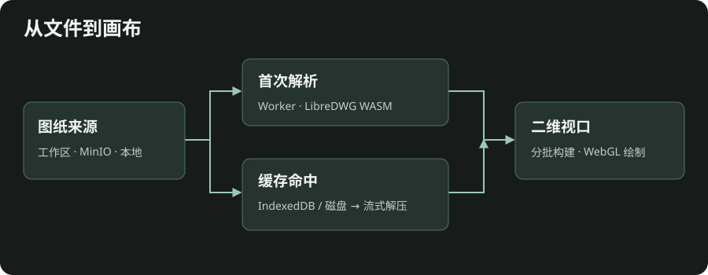
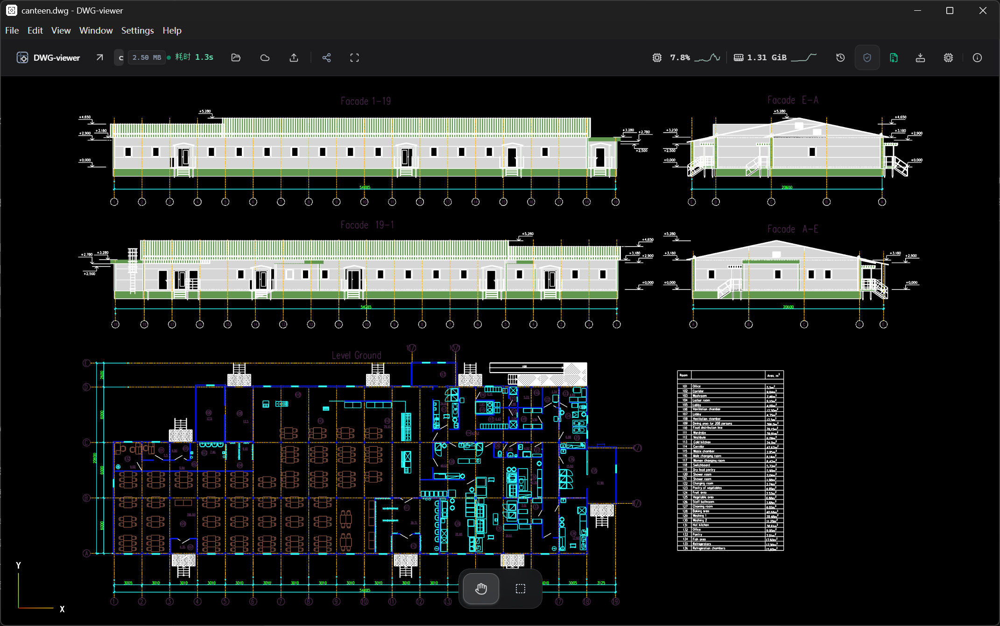
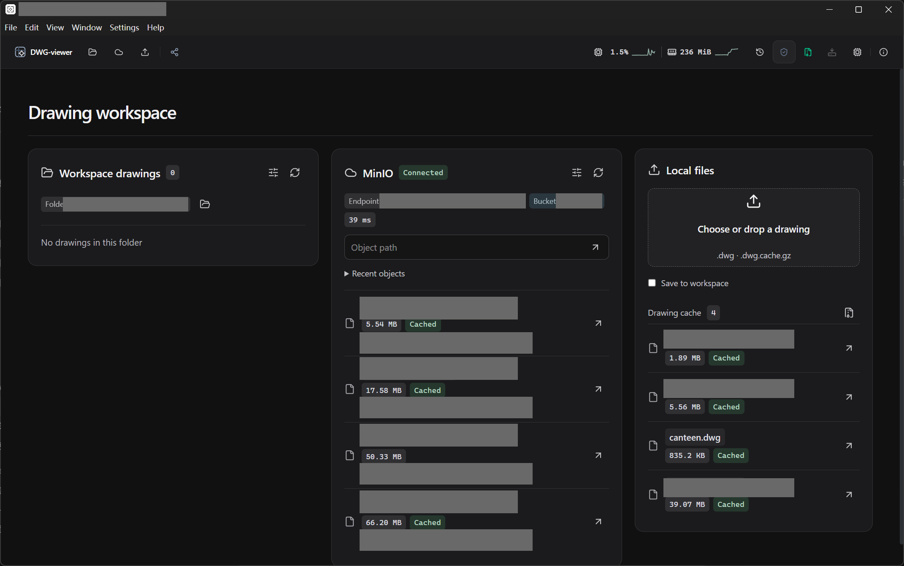
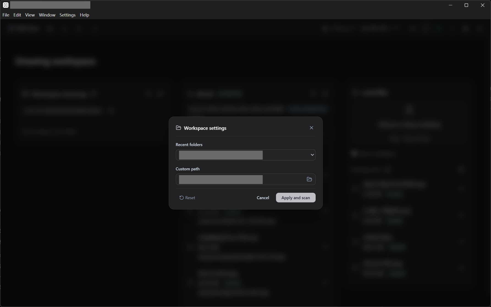
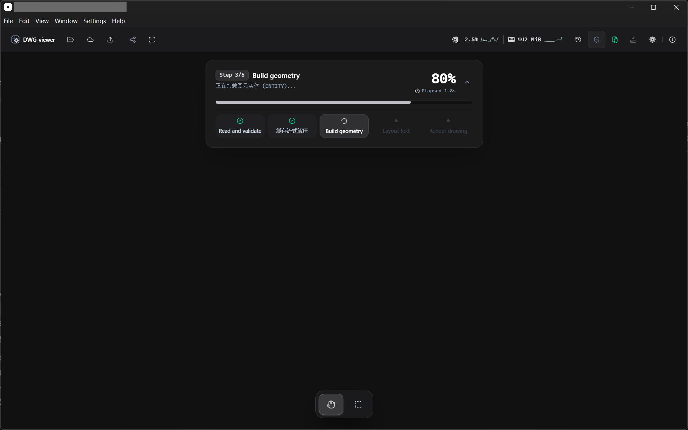

# DWG-viewer

## 项目设计初衷

我们想做一款免费的开源 DWG 演示软件，让工程师和项目团队在会议、现场沟通或内部业务系统中，直接打开图纸、定位细节、讲解方案。Windows 用户可以安装桌面版，开发团队也可以把同一套预览能力移植到自己的 Web 系统。

选择 Web 技术的好处是，**图纸解码和画布渲染可以独立于业务系统复用**。工作区、MinIO 或本地文件提供 DWG 字节；Web Worker 调用 LibreDWG WebAssembly 解码，整理二维图元；MLightCAD 与 Three.js 将几何和文字绘制到 WebGL 画布。Electron 为这套前端补上本机文件选择、菜单和资源监控。内部系统可以保留自己的登录、文件权限和存储服务，把授权后的文件交给预览引擎；下文给出 Vue 组件与 iframe 两种接入方式。

当前仓库公开源码，尚未声明项目级许可证。私有系统复用或再分发前，请确认项目授权及所用依赖的许可条件。

[下载 Windows x64 安装包](https://github.com/JHJ1848/DWG-viewer/releases/latest) · [查看演示图纸](public/samples/canteen.dwg)

## 功能与优化

| 场景 | 使用方式与实现 |
| --- | --- |
| 打开图纸 | 切换工作区目录、浏览 MinIO 对象，或选择和拖入本地 DWG、压缩缓存文件。桌面版提供原生目录选择，MinIO 可配置端点和存储桶。 |
| 演示与导航 | 在画布上缩放、平移、框选、适配视图。返回工作台再进入详情可保留当前图纸与视角；选择另一张图纸时切换活动文档。工作区与 MinIO 路由支持复制链接，接收端需有对应文件和访问权限。 |
| 首次打开大图 | Worker 承担解码，视口按批构建实体，进度面板展示当前阶段与耗时。内存优化模式限制渲染分辨率并调整分批策略，降低峰值占用，加载耗时可能增加。 |
| 再次打开 | IndexedDB 与服务端磁盘保存 Gzip 预览缓存。命中时走流式解压路径，减少重复 DWG 解码。缓存面板支持载入、下载缓存包、重新解析及清理。 |
| 工程图显示 | 二维预处理修正闭合多段线与部分等高线；聚簇取景减轻远处孤立图元对初始视图的影响。字体资源、富文本排版及 OLE 栅格化改善文字与嵌入表格的可读性。 |
| 桌面使用与诊断 | 中英文菜单和主要组件、GPU / WebGL 信息、应用进程 CPU 与内存趋势。Windows 版从 3000 起选择可用端口，同机浏览器可访问桌面服务。 |



## 实际效果

**二维画布** · 内置 canteen.dwg 同时展示建筑立面、平面、轴线标注和表格。



| 图纸工作台 | 工作区设置 |
| --- | --- |
|  |  |

**加载过程** · 示例截取了缓存解压完成、正在构建图元的阶段。截图中的耗时和资源占用来自当次运行。



## 快速上手与开发指南

### 1. 环境准备与系统条件
- **Node.js**: 推荐 `v18.x` 或 `v20.x` LTS（全平台通用）；
- **包管理器**: `npm`（建议随 Node 自带版本，或使用 `pnpm` / `bun`）；
- **操作系统环境条件**:
  - **Web 端与核心服务**: 支持 Windows 10/11、macOS、Linux 全平台；
  - **Windows 桌面端 (Electron)**: 调试与打包需在 Windows 操作系统环境下执行。

### 2. 初始化与安装命令
```bash
# 1. 解压后进入项目根目录
cd DWG-viewer

# 2. 安装全部项目依赖（会自动触发 postinstall 钩子执行 OLE 高清光栅化补丁）
npm install

# 3. 编译生产后端服务脚本 (输出 electron/server.cjs)
npm run build:server

# 4. 前端工程构建验证 (输出 dist 静态资源)
npm run build
```

### 3. 常用运行与发版命令
```bash
# Web 端全功能开发调试（支持本地 3000 端口同源服务）：
npm run dev

# 单元测试（19 项用例自测）：
npm test

# Windows 桌面端调试（需 Windows 环境）：
npm run electron:dev

# Windows 桌面端发版打包（输出 NSIS 安装包到 release/<版本号>/，需 Windows 环境）：
npm run electron:build

# 若 Windows 资源编辑器 rcedit 报错，可在前两项构建成功后生成未签名安装包：
# npx electron-builder --win "-c.win.signAndEditExecutable=false" --publish never
```

---

## 一、DWG 预览整体技术路线（四层架构）

本项目采用 **“纯浏览器端 WebAssembly 二进制解码 + Web Worker 多线程异步转换 + Three.js WebGL 硬件加速二维渲染”** 的技术路线，无需后端安装 AutoCAD 或商业转换服务即可直接解析原始 `.dwg` 二进制文件（支持 R13 ~ AutoCAD 2018+ 即 `AC1012` ~ `AC1032`）。

### 全链路数据流转过程

```text
[数据源: MinIO 预签名 URL / Spring 文件流 / 本地 .dwg 文件]
       │
       ▼ 1. 读取二进制流 (ArrayBuffer) + 校验文件头前6字节 (AC10xx)
[主线程: DwgViewerEngine (dwgViewerEngine.ts)]
       │
       ▼ 2. 零拷贝移交后台线程 (Web Worker)
[Worker 线程: libredwgParserWorker.ts + libredwg-web.wasm]
       ├─ (a) LibreDwg.dwg_read_data()：C/WASM 层解码 DWG 原始二进制字节流
       ├─ (b) instance.convertEx(dwg)：提取为纯 JSON 结构的中间数据 (DwgDatabase)
       └─ (c) normalizeDwgDatabaseFor2DPreview()：归一化修复（拍平测绘高程 Z=0、开启非打印网格图层、修复闭合多段线与样条顶点）
       │
       ▼ 3. 返回结构化中间数据 (result.database)
[转换与内存数据库层: @mlightcad/libredwg-converter + @mlightcad/data-model]
       ├─ 将 JSON 中间数据构建为标准 CAD 内存文档树 (AcDbDatabase)
       ├─ 解析图层表 (LAYER)、线型表 (LTYPE)、文字样式 (STYLE)、块表记录 (BLOCK_RECORD)
       └─ 异步加载匹配 CAD 矢量字体 (.shx / 中文字体) 并通过 mtext-renderer-worker 排版富文本
       │
       ▼ 4. 几何离散化与 GPU 批次合并渲染
[渲染与交互层: @mlightcad/cad-simple-viewer + @mlightcad/three-renderer + Three.js]
       ├─ 将直线、圆弧、多段线、样条曲线、填充、块引用转换为 Three.js BufferGeometry
       ├─ 自动检测并切换至有效空间（若图纸保存在空布局页则自动切回 Model 模型空间）
       ├─ 执行智能聚簇居中 (zoomToSmartExtents)，过滤远离主图的坐标原点/飞点
       └─ 提供 WebGL 视口原生交互（鼠标滚轮缩放、拖拽平移）
```

---

## 二、项目完整目录结构

```text
├── index.html                        # 页面入口 HTML
├── package.json                      # 依赖与构建脚本配置
├── vite.config.ts                    # Vite 构建与打包配置
├── README.md                         # 技术路线、项目结构与 Vue + Spring + MinIO 交接文档
├── ARCHITECTURE_AND_HANDOVER.md      # 架构与交接文档独立备份
├── public/                           # 【静态资源层】编译后原样映射至站点根目录 "/"
│   ├── wasm/
│   │   └── libredwg-web.wasm         # LibreDWG C 语言编译出的 WebAssembly 核心解码库
│   ├── workers/
│   │   └── mtext-renderer-worker.js  # MTEXT 多行文本与 SHX 矢量字体几何排版 Worker
│   ├── fonts/                        # CAD 矢量字体库 (.shx / 中文字体，解决中文乱码与问号)
│   ├── templates/                    # CAD 视图默认空白初始化模板
│   └── samples/                      # 内置示例图纸 (canteen.dwg)
└── src/                              # 【核心源码层】
    ├── main.tsx                      # React 挂载入口
    ├── index.css                     # Tailwind 全局基础样式
    ├── App.tsx                       # 极简 UI 外壳（地址输入栏、上传按钮、全屏视口容器）
    ├── core/
    │   └── dwgViewerEngine.ts        # 【核心】框架无关的 DWG 预览引擎类（可直接迁入 Vue）
    ├── workers/
    │   └── libredwgParserWorker.ts   # 【核心】DWG 解析 Web Worker（含等高线/网格线归一化修复）
    └── utils/
        ├── dwgValidation.ts          # DWG 二进制文件头校验与 MinIO URL 文件名提取工具
        └── dwgValidation.test.ts     # 校验与 URL 解析工具的单元测试
```

---

## 三、各文件与模块的具体职责分工

### 1. 核心业务源码 (`src/`)

| 文件路径 | 角色定位 | 具体职责分工 |
| :--- | :--- | :--- |
| **`src/core/dwgViewerEngine.ts`** | **无框架依赖的核心引擎类**（迁移核心） | 1. **`mount(container)`**：在传入的任意 DOM 容器上初始化 `@mlightcad/cad-simple-viewer` 单例（关闭冗余命令行/编辑工具栏，绑定 WASM Worker 与字体路径）。<br>2. **`loadFromUrl(url, options)`**：通过 `fetch` 拉取 MinIO 预签名地址或带 `Authorization` Header 的 Spring Boot 文件流，转为 `ArrayBuffer` 后交由解析管线渲染。<br>3. **`loadFromBuffer(fileName, buffer)`**：校验文件头后调用 `docManager.openDocument` 异步解码并渲染图纸。<br>4. **`ensureModelSpaceActive()`**：自动识别“保存在空白布局页（Paper Space）的总平图”，自动切换回包含完整图元的模型空间（Model Space）。<br>5. **`fitToView()`**：调用智能聚簇包围盒算法（`zoomToSmartExtents`），自动排除测绘图中远离主图的 `(0,0)` 原点飞点并居中展示。 |
| **`src/workers/libredwgParserWorker.ts`** | **后台解码与数据归一化 Worker**（迁移核心） | 1. 运行在独立 Web Worker 线程，加载 `/wasm/libredwg-web.wasm` 解码 DWG 原始字节流，避免大文件（50~100MB）阻塞浏览器主线程。<br>2. 调用 `instance.convertEx(dwg)` 生成纯 JSON 结构的 `result.database`（**这也是后续做中间数据持久化缓存的切入点**）。<br>3. **`normalizeDwgDatabaseFor2DPreview()`**：针对二维工程预览进行数据修正：<br>　• 将所有图层 `plotFlag` 置为 `1`，解决 CAD 中设为“不打印”的坐标网格线、辅助轴线被默认隐藏的问题；<br>　• 将所有图元与块内顶点的 `elevation` / `z` 坐标统一拍平至 `0`，解决带真实海拔（如 `Z > 500m`）的测绘等高线超出正交相机远裁剪面（`far=1000`）被整条裁切的问题；<br>　• 修正 `LWPOLYLINE` 闭合标志位（`512 -> 1`）与 `POLYLINE2D` 样条控制点过滤问题。 |
| **`src/utils/dwgValidation.ts`** | **二进制校验与 URL 工具**（迁移核心） | 1. **`inspectDwgHeader(buffer)`**：读取文件前 6 个字节签名（如 `AC1015`、`AC1027`、`AC1032`），校验是否为真实 AutoCAD DWG 二进制流并识别版本。<br>2. **`extractFileNameFromUrl(url)`**：从带签名参数的 MinIO 预签名 URL 或 Spring 下载地址中提取干净的 `.dwg` 文件名。<br>3. **`validateDwgFileName()` / `formatByteSize()`**：后缀校验与文件体积格式化。 |
| **`src/App.tsx`** | **极简预览界面壳** | 1. 提供顶部操作栏：MinIO / 内部 URL 输入框、**「加载地址」**按钮、**「居中复位」**按钮、**「上传 DWG」**按钮。<br>2. 支持解析浏览器地址栏 `?url=` / `?minioUrl=` 参数自动加载远程图纸。<br>3. 监听 `window.addEventListener('message')`，支持作为 `<iframe>` 嵌入现有系统时接收父页面发来的 `LOAD_DWG_URL` 或 `LOAD_DWG_BUFFER` 指令。 |

### 2. 静态资源目录 (`public/`)

| 目录/文件路径 | 为什么必需 | 职责说明 |
| :--- | :--- | :--- |
| **`public/wasm/libredwg-web.wasm`** | **必需** | LibreDWG C 源码编译而成的 WebAssembly 二进制模块，`libredwgParserWorker.ts` 启动时会从 `/wasm/libredwg-web.wasm` 加载它来执行底层字节解码。 |
| **`public/workers/mtext-renderer-worker.js`** | **必需** | 负责在后台线程解析 CAD 复杂多行文本（`MTEXT`）转义符并将矢量字形三角化为 WebGL 网格。 |
| **`public/fonts/`** | **必需** | 存放 CAD 标准 `.shx` 字体及中文字体文件；若缺失此目录，图纸中的中文说明、高程标注、轴号会无法渲染或显示为问号。 |
| **`public/templates/`** | **必需** | `@mlightcad/cad-simple-viewer` 初始化文档管理器时的基础空模板文件。 |
| **`public/samples/`** | 可选 | 内置演示用的两个标准 `.dwg` 样本文件，迁移到生产环境后可按需删除。 |

### 3. 核心第三方依赖包分工 (`package.json`)

- **`@mlightcad/libredwg-web`**：封装了 `libredwg-web.wasm` 的底层绑定，负责把二进制 `ArrayBuffer` 转为 JS 对象 `DwgDatabase`。
- **`@mlightcad/libredwg-converter`**：桥接转换器，负责调度 `libredwgParserWorker.ts` 并将 `DwgDatabase` 转换为引擎内部实体模型。
- **`@mlightcad/data-model`**：CAD 内存数据库模型（提供 `AcDbDatabase`、图层表、块表、布局管理器及各类二维/三维图元数据结构）。
- **`@mlightcad/three-renderer` & `three`**：基于 Three.js WebGL 的 CAD 二维正交相机渲染器，负责将海量 CAD 线段、圆弧、文字合并批次（Batching）交由 GPU 高帧率绘制。
- **`@mlightcad/cad-simple-viewer`**：顶层文档与视口控制器（`AcApDocManager`），管理画布生命周期、鼠标滚轮缩放、拖拽平移与智能聚簇居中。

---

## 四、迁移至现有 Web 系统 (Vue + Spring Boot + MinIO) 指南

### 1. 安装核心依赖

在现有的 Vue (Vite) 项目中安装以下核心包：

```bash
npm install @mlightcad/cad-simple-viewer@^1.7.6 \
            @mlightcad/data-model@^1.15.11 \
            @mlightcad/libredwg-converter@^3.15.11 \
            @mlightcad/libredwg-web@^0.8.1 \
            @mlightcad/three-renderer@^1.7.6 \
            @mlightcad/mtext-parser@^1.5.5 \
            @mlightcad/mtext-renderer@^0.13.5 \
            @velipso/polybool@^2.0.11 \
            lodash-es@^4.18.1 \
            three@^0.186.1
```

### 2. 拷贝静态资源与核心源码

1. 将本项目的 `public/wasm`、`public/workers`、`public/fonts`、`public/templates` 四个目录原样复制到 Vue 项目的 `public/` 目录下。
2. 将以下 3 个源码文件复制到 Vue 项目的 `src/` 对应目录中：
   - `src/core/dwgViewerEngine.ts`
   - `src/workers/libredwgParserWorker.ts`
   - `src/utils/dwgValidation.ts`

---

### 3. 接入方式 A：在 Vue 3 组件中直接调用 `DwgViewerEngine`（推荐）

```vue
<template>
  <div class="dwg-viewer-wrapper">
    <!-- 顶部极简控制栏 -->
    <div class="toolbar">
      <span>{{ fileName }} ({{ fileSize }})</span>
      <button @click="handleFitView">居中复位</button>
      <span v-if="loading" class="progress-info">
        [节点 {{ currentStep }}/5] {{ stageTitle }} · {{ percent }}% (耗时 {{ elapsed }})
      </span>
      <span v-if="errorMsg" class="error">{{ errorMsg }}</span>
    </div>

    <!-- WebGL 渲染画布容器 -->
    <div ref="viewportRef" class="viewport-canvas"></div>
  </div>
</template>

<script setup lang="ts">
import { ref, onMounted, watch } from 'vue';
import { DwgViewerEngine } from '@/core/dwgViewerEngine';

const props = defineProps<{
  /** Spring Boot 返回的 MinIO 预签名地址或后端文件流接口地址 */
  minioFileUrl: string;
  /** 可选：若走 Spring Boot 鉴权文件流接口，可传入 JWT Token */
  authToken?: string;
}>();

const viewportRef = ref<HTMLElement | null>(null);
const loading = ref(false);
const percent = ref(0);
const currentStep = ref(1);
const stageTitle = ref('');
const elapsed = ref('0.0s');
const fileName = ref('');
const fileSize = ref('');
const errorMsg = ref('');

let engine: DwgViewerEngine | null = null;

const loadDwg = async (url: string) => {
  if (!engine || !url) return;
  errorMsg.value = '';
  await engine.loadFromUrl(url, {
    headers: props.authToken
      ? { Authorization: `Bearer ${props.authToken}` }
      : undefined,
  });
};

const handleFitView = () => {
  engine?.fitToView();
};

onMounted(() => {
  if (!viewportRef.value) return;

  engine = new DwgViewerEngine({
    onProgress: (state) => {
      loading.value = state.isLoading;
      percent.value = state.percent;
      currentStep.value = state.currentStep;
      stageTitle.value = state.stageTitle;
      elapsed.value = state.elapsedSeconds;
    },
    onLoaded: (meta) => {
      fileName.value = meta.fileName;
      fileSize.value = meta.fileSizeLabel;
    },
    onError: (msg) => {
      errorMsg.value = msg;
    },
  });

  engine.mount(viewportRef.value);

  if (props.minioFileUrl) {
    void loadDwg(props.minioFileUrl);
  }
});

watch(
  () => props.minioFileUrl,
  (newUrl) => {
    if (newUrl) void loadDwg(newUrl);
  }
);
</script>

<style scoped>
.dwg-viewer-wrapper {
  display: flex;
  flex-direction: column;
  width: 100%;
  height: 100%;
  background: #0b0e17;
  color: #f1f5f9;
}
.toolbar {
  height: 44px;
  padding: 0 12px;
  display: flex;
  align-items: center;
  gap: 12px;
  background: #0f1624;
  border-bottom: 1px solid #1e293b;
}
.viewport-canvas {
  flex: 1;
  position: relative;
  overflow: hidden;
}
.error {
  color: #fb7185;
}
</style>
```

---

### 4. 接入方式 B：独立部署并通过 `<iframe>` 嵌入现有 Vue 页面

如果不希望在主工程中引入 `@mlightcad/*` 与 WASM 构建配置，可直接将本工程打包（`npm run build`）作为独立静态子服务部署，在 Vue 页面中通过 `<iframe>` 集成：

1. **通过 URL 参数直接指定 MinIO 地址**：
   ```html
   <iframe
     src="/dwg-viewer/index.html?url=https%3A%2F%2Fminio.internal%2Fbucket%2Fsite-plan.dwg"
     style="width: 100%; height: 100%; border: none;"
   ></iframe>
   ```
2. **通过 `postMessage` 动态传递带鉴权 Header 的地址或二进制流**：
   ```ts
   // Vue 父页面调用：
   iframeRef.value?.contentWindow?.postMessage(
     {
       type: 'LOAD_DWG_URL',
       url: 'https://api.internal/spring/files/dwg/1024',
       fileName: '总平图.dwg',
       headers: { Authorization: `Bearer ${jwtToken}` },
     },
     '*'
   );
   ```

---

## 五、已解决的渲染细节问题 & 后续待办 (TODO)

### 已在 `src/workers/libredwgParserWorker.ts` 落地的等高线/网格线修复
针对测绘/总平图（如 CASS、Civil 3D 图纸）中等高线、坐标方格网与非打印辅助图层不显示的问题，已在 Worker 解析输出 `result.database` 阶段完成以下 4 项归一化修复：

1. **非打印图层（`plotFlag = 0`）强制可视**：
   - **原因**：CAD 中坐标网格线、图框辅助线、`Defpoints` 常被设为“不打印（Plot = No）”，在 AutoCAD 窗口内正常可见；但 `@mlightcad/cad-simple-viewer` 默认按 `visible = !(isFrozen || isOff || !isPlottable)` 将 `plotFlag === 0` 的图层隐藏。
   - **处理**：在 `normalizeDwgDatabaseFor2DPreview` 中统一将图层 `plotFlag` 设为 `1`，确保非打印图层在预览视口中正常展示。
2. **三维高程 `Z` 坐标拍平至 `Z = 0`（解决高海拔等高线被相机视锥体裁切）**：
   - **原因**：`@mlightcad/three-renderer` 的二维正交相机位于 `z = 500`、`near = 0.1, far = 1000`，仅渲染 `Z ∈ [-500, 499.9]`。测绘等高线往往带有真实海拔（如 `elevation = 600m ~ 2500m`），超出视锥体范围后会被 WebGL 直接整条裁切。
   - **处理**：将模型空间与所有图块内的 `LWPOLYLINE`、`POLYLINE2D`、`POLYLINE3D`、`SPLINE`、`LINE`、`ARC`、`CIRCLE`、`INSERT`、`TEXT/MTEXT`、`POINT` 的 `elevation` 与顶点 `z` 统一归零。
3. **`POLYLINE2D` 样条拟合等高线顶点保护**：
   - **原因**：CASS 等高线常使用二次/三次样条拟合 `POLYLINE2D`，若顶点仅含样条控制帧标志位（`flag & 16`），转换器默认过滤 `(v.flag & 16) === 0` 会导致顶点数组为空，整条等高线消失。
   - **处理**：当检测到多段线仅含 `flag & 16` 控制顶点时，自动保留其顶点序列。
4. **`LWPOLYLINE` 闭合位兼容（`512` -> `1`）**：
   - **处理**：将 LibreDWG 的 `flag & 512` 同步置位到 `flag |= 1`，确保闭合网格与闭合多段线不丢最后一段闭合边。

### 已落地的双层 Gzip 缓存引擎（L1 浏览器 IndexedDB + L2 服务端磁盘）
1. **DWG 指纹计算 (`computeDwgFingerprint`)**：对 DWG 二进制流采样（头 64KB + 中部 64KB + 尾 64KB + 文件字节长度）计算 FNV-1a 64-bit 指纹（如 `dwg-v1-a8d08bf36d57fb06-226576`），耗时 `< 1ms`。
2. **DWG 中间 JSON 瘦身 (`stripDwgDatabaseForCache`)**：自动剔除 `@mlightcad/libredwg-web` 在顶层 `db.entities` 与 `BLOCK_RECORD.entities` 之间重复生成的冗余模型空间实体引用及无用 `xdata`，在零损画质前提下将序列化 JSON 体积缩减约 `45%`~`55%`。
3. **双层 Gzip 缓存读写 (`src/utils/dwgGzipCache.ts` + `src/utils/dwgLocalCacheStore.ts` + `server.ts`)**：
   - **L1 浏览器本地缓存**：基于 Web 原生 `CompressionStream('gzip')` / `DecompressionStream('gzip')` 与 `IndexedDB`，单机二次打开跳过 `libredwg-web.wasm` 二进制解码。
   - **L2 服务端共享缓存 (`/api/dwg-cache/:fingerprint`)**：服务端将 `.dwg.json.gz` 与 `.meta.json` 持久化在 `.cache/dwg-gzip/` 目录，桌面生产环境使用用户目录下的缓存。再次打开时可读取 L2 并回填本地 L1，减少重复解析。

### 后续待办清单 (TODO)

#### TODO：特殊测量网格图元扩展（按需补充）
- **`DWG_TYPE_MINSERT` (固定类型 `8`，块矩形阵列)**：部分测绘院图纸使用 `MINSERT` 生成十字丝坐标网格。若遇到此类图纸网格缺失，可在 Worker 中将 `MINSERT` 展开为 `num_rows × num_cols` 个普通 `INSERT` 图元推入 `result.database.entities`。
- **`DWG_TYPE_XLINE` / `DWG_TYPE_RAY` (构造线 / 射线)**：部分建筑轴网使用无限长构造线 `XLINE`，可在 Worker 中按图纸包围盒范围将其裁剪转换为普通 `LINE` 线段以供预览。
